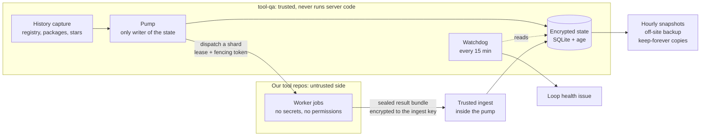

# tool-qa

**IsoKron's continuous testing loop.** It runs our open-source MCP tools against
nearly a thousand open-source MCP servers, around the clock, on free GitHub
Actions runners. When one of our tools gets a server wrong, that becomes a fix,
a named regression test and a new release. Every result is kept.

[](https://github.com/isokron-ai/tool-qa/actions/workflows/pump.yml)
[](https://github.com/isokron-ai/tool-qa/actions/workflows/watchdog.yml)
[](https://github.com/isokron-ai/tool-qa/actions/workflows/test.yml)

**Live status:** the watchdog rewrites the [Loop health issue](https://github.com/isokron-ai/tool-qa/issues/40)
every 15 minutes. Every run is in the [Actions tab](https://github.com/isokron-ai/tool-qa/actions).

More about IsoKron: [isokron.ai](https://isokron.ai/?utm_source=tool-qa&utm_medium=readme).

## At a glance (24 Nov 2026)

| | |
|---|---|
| Servers in the loop | **997** open-source MCP servers (the [seed list](history/seed-v1.json)) |
| Results recorded | **2,872** accepted results; every attempt, accepted or rejected, is kept |
| Official MCP registry | captured **every 15 minutes**, plus a full copy daily |
| Bugs fixed and pinned by a test | **330**, across 5 of our repos ([regression ledger](docs/LEDGER.md)) |
| Tests in this repo | **1,200+**, plus a randomized [chaos soak](chaos/) of the whole loop |
| Hosting cost | **$0**: free public Actions runners and free storage tiers |

## How it works



Each pump tick follows one piece of work through these steps:

1. **Work out what is due.** There is no queue to lose: the pump recomputes
   the due list from the state every tick. A server is due when it changed,
   when one of our tools released a new version, or when its last result is
   older than its tier allows. A missed run catches up on its own.
2. **Take a lease.** Each lease carries a fencing token from a counter that
   only goes up. A worker that stalls loses its lease. When it reports late,
   its result is refused as `stale_fence`.
3. **Take a slot.** GitHub's concurrency limits stop at the repo boundary, so
   the pump keeps its own slot ledger across repos, leaving room for normal CI.
4. **Dispatch.** A shard of servers goes to a worker workflow in the tool's own
   repo. The loop doubles as that tool's regression suite.
5. **Seal.** The worker gets no secrets and no write permissions. It can only
   return a result bundle encrypted to the ingest key.
6. **Judge.** The ingest decrypts and checks the bundle against the lease that
   sent it out: the commit, the identity and the size limits. It also redacts
   anything secret-shaped. A worker's own exit status never decides whether
   its result is accepted.
7. **Record and save.** Every attempt is stored, never overwritten. The state
   is saved before the next dispatch goes out, so a killed job can't leave
   work the state doesn't know about.

The architecture in full: [docs/ARCHITECTURE.md](docs/ARCHITECTURE.md) and
[docs/INTERFACES.md](docs/INTERFACES.md).

## Design choices

- **Trust boundary first.** This repo never runs third-party code. Code that
  does run it lives in sandboxed worker jobs, and their output is treated as
  hostile until the ingest has checked it.
- **A circuit breaker on the sandbox.** Lanes that run server code stay held
  unless the nightly sandbox conformance run passed within 36 hours.
  - It must be a verified run on main.
  - An older or forged status can't reopen it.
- **One writer.** Only the pump writes the state. Pump runs go back to back,
  and each dispatches its successor before it starts work.
- **Encrypted at rest.** The state is an age-encrypted release asset in a
  public repo. A push that could not be read back is refused.
- **Separate claims, never one score.** The loop measures six things about a
  server and never folds them into a grade. Untested is never shown as failed,
  and a limit of our tool is never counted against the server
  ([MEASUREMENTS.md](docs/MEASUREMENTS.md)).
- **Silence is a failure.** The watchdog turns a stale artifact, a missing
  snapshot or a pump that stopped into amber or red on the health issue.
- **Nothing is lost.**
  - Hourly encrypted snapshots, with a restore drill.
  - A six-hourly off-site backup, in a bucket whose lock rule keeps every object for 30 days.
  - Compressed keep-forever copies of every result artifact.

## Bugs become tests

Every bug found in our tools or in the loop gets an ID and a written cause.
It also gets the named test that pins it. Each repo keeps a `REGRESSIONS.md`,
and [the ledger](docs/LEDGER.md) gathers all of them in one place and
refreshes daily.

The 330 entries so far were found by:
- code review (156);
- self-tests (22);
- design checks (20);
- CI (13);
- the chaos suite (7);
- mutation runs (7);
- live runs (1);
- an unrecorded source (104).

Mutation runs switch a protection off and confirm its test then fails.

A few from this repo's [REGRESSIONS.md](REGRESSIONS.md):

- **R-ING-01:** a redaction pattern was quadratic, so one crafted bundle could
  hold the pump past its job timeout. Now pinned at linear time on 1 MiB.
- **R-ING-10:** dispatches were sent before the state recording them was
  saved. Now the state is saved first.
- **R-WD-09:** a forged red status could poison the breaker's memory and keep
  it open for good. Now nothing is remembered until the run behind it is
  verified.

## What runs today

| Lane | What it does | Status |
|---|---|---|
| `scan-static` ([mcp-check](https://github.com/isokron-ai/mcp-check)) | Reads each server's source and grades its tool definitions, without running it | **On** |
| History capture | Official MCP registry, package releases, downloads and stars | **On** |
| Backups and retention | Snapshots, off-site backup, keep-forever copies | **On** |
| `live-probe`, `scan-deep`, `build-probe`, `writecheck` | Run server code in the sandbox: protocol conformance, deeper scans, builds, write safety | Built, switched off for now |
| `meta-github`, `meta-registry`, `release-diff` | Public metadata, and published packages compared with their source | Built, switched off for now |

Results go public later, through [isokron-ai/mcp-results](https://github.com/isokron-ai/mcp-results).
Security findings are never published before their disclosure window.

## How to stop it

Set these as repository variables (Settings → Secrets and variables → Actions →
Variables), or with `gh variable set NAME --body VALUE --repo isokron-ai/tool-qa`.

| Variable | Effect |
|---|---|
| `LOOP_ENABLED` | Must be exactly `true` for anything to run. **Set it to `false` to stop everything in one step.** Unset means off. |
| `LOOP_SLOTS` | Whole number of worker slots, 0 to 15. Default 0: no work is sent out, and the pump only tidies up (judges finished worker runs, reaps expired leases and slots). Values above 15 count as 15. Set it to 5 or less to shrink the loop at once. |
| `LOOP_PAUSE_UNTIL` | Optional ISO 8601 time, such as `2026-12-01T09:00:00Z`. The loop does nothing until then. A value the guard can't read keeps the loop paused. |
| `LANE_<JOB>_ENABLED` | Optional per-job switch, for example `LANE_HISTORY_ENABLED=false`. Unset leaves the job on. |

Every scheduled or dispatched loop job first runs [`scripts/guard.mjs`](scripts/guard.mjs).
A stopped loop exits cleanly (green, with a one-line notice), never red. Every
workflow starts from `permissions: {}`, every job asks only for what it needs,
and every action is pinned to a full commit SHA. actionlint, zizmor and
[`scripts/check-workflows.mjs`](scripts/check-workflows.mjs) run on every push
and pull request. Details, and what to do in an emergency:
[docs/OPERATIONS.md](docs/OPERATIONS.md).

## Repository layout

| Path | What it is |
|---|---|
| `pump/` | The pump: subjects from the seed list, due list, shards, slots, leases, dispatch, API budgets, the sandbox breaker |
| `ingest/` | Trusted ingest: decrypts a worker's sealed result and checks it before anything is recorded; the pump runs it every tick |
| `worker-kit/` | The result contract workers follow: manifest schema, bundle builder, sealing action, ingest public key |
| `state/` | The state store (schema and migrations) and the pruning of closed history |
| `watchdog/` | Loop health checks and the "Loop health" issue |
| `history/` | Official registry, package and popularity capture, and the seed list |
| `meta/`, `longitudinal/` | Metadata lanes, release-diff, and drift at an unchanged release (moved tags, changed artifacts) |
| `snapshot/`, `offsite/`, `keep/` | Hourly snapshots and the restore drill, off-site backup, keep-forever copies |
| `chaos/` | A simulated GitHub and seeded random faults played against the whole loop |
| `perf/` | Performance baselines for our own servers ([docs/PERFORMANCE.md](docs/PERFORMANCE.md)) |
| `ledger/`, `scripts/ledger.mjs` | The cross-repo regression ledger ([docs/LEDGER.md](docs/LEDGER.md)) |
| `scripts/` | The kill-switch guard, the workflow policy check, the state asset pull and push, the archive pull |
| `docs/` | Architecture, interfaces, operations, measurements, performance, the ledger |

## Development

Node 22.15 or newer (zstd in zlib). No runtime dependencies.

```sh
npm test                 # node --test
npm run check-workflows  # policy check on .github/workflows
```

Every change gets an independent review, green CI and signed commits before it
merges. See [CONTRIBUTING.md](CONTRIBUTING.md).

## License

[MIT](LICENSE). Security reports: see [SECURITY.md](SECURITY.md).
